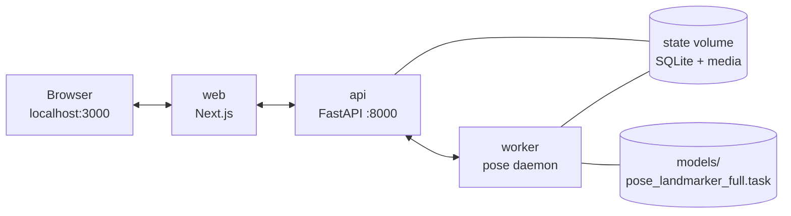

# Motion X Ray

Upload a short workout video, review its pose overlay and measured movement report,
compare available reference measurements, and request grounded coaching. Browser
recording is available; estimated 3D motion replay in the main app remains a
roadmap feature.

> This repository is building towards the product described in
> `docs/PRODUCT.md`. It is **not** a validated biomechanics product. Scores
> express *similarity to a selected reference*, not correctness, safety, or
> effectiveness.

## Quickstart (canonical)

The canonical entry point is `./scripts/quickstart.sh`. It prepares `.env`,
downloads and verifies the pinned pose model, builds images, and starts the
stack. The first build downloads dependencies and the ~9.4MB pose model
from the network; core analysis then needs no external inference service. Docker builds may still
check image registries; a fully offline bootstrap is not guaranteed.

```bash
git clone https://github.com/Viggy1357/motion-xray.git
cd motion-xray
./scripts/quickstart.sh
```

### Prerequisites

- Docker Compose v2 running.
- Git.
- Bash (WSL2 on Windows; native Windows is **not verified**).
- macOS / Linux: only Apple Silicon has been locally verified.
- Network access on first build (dependency + model download).

### What the script does

1. Generates `.env` from `.env.example` with a persistent `SESSION_SECRET`
   (never printed). The secret is written once and reused.
2. Downloads the pinned pose model to `models/pose_landmarker_full.task`
   and verifies its SHA256 against `data/pose_models/mediapipe-full-v1.json`.
3. Builds and starts `web`, `api`, and `worker` via
   `docker compose -f infra/compose.yaml up --build`.
4. Checks API `/healthz` and the web root inside the Compose network,
   and confirms the worker remains running. Open the host URL below afterward.

### After first build

- Core perception runs **locally**; no API key is required.
- Coaching is **off** by default. To enable grounded Nemotron coaching,
  edit `.env`:
  - `ALLOW_LIVE_COACHING=true`
  - `NEBIUS_MODEL_ID=nvidia/NVIDIA-Nemotron-3-Nano-30B-A3B`
  - `NEBIUS_API_KEY=<your key>` (server-side only; never printed)
  Then recreate the API to apply the edited environment:
  ```bash
  docker compose --env-file .env -f infra/compose.yaml up -d --force-recreate api
  ```
  Recreation applies the edited container environment. No fake offline coach is provided.

### Using the app

- Open `http://localhost:3000` in your browser.
- Upload your own clip (under60s, under100MiB) or record from the camera on
  `localhost` (consent required). No private clip is bundled.
- Analysis is deterministic on CPU and may take several minutes per clip;
  no ETA is shown.

### Stopping

```bash
# Stop the stack while preserving its state volume
docker compose -f infra/compose.yaml down
```

Do **not** pass `-v`; the state volume holds the SQLite database and
uploaded media.

### Prepare-only mode

```bash
./scripts/quickstart.sh --prepare-only
```

Generates `.env` and downloads/verifies the model without starting the
stack. Use this to pre-warm a fresh clone.


## NVIDIA Nemotron and Nebius usage

The required NVIDIA-model call is the optional grounded coaching path. It is
**distinct** from the core perception path and is **off** by default.

- **Runtime model**: `nvidia/NVIDIA-Nemotron-3-Nano-30B-A3B`, hosted via the
  Nebius Token Factory OpenAI-compatible server-side endpoint. The model is
  selected for a bounded, low-latency, low-cost coaching task; no benchmark
  claim is made.
- **Selection logic**: the server-side path selects only evidence-linked
  coaching IDs that are eligible for the current clip. Local validation and
  fixed text are used; the model never receives raw video and never invents
  numeric measurements.
- **Deterministic measurements**: pose and rep measurements are produced
  deterministically on CPU using MediaPipe; they are kept separate from the
  Nemotron coaching call.
- **Historical record**: one real owned-set `Generate coaching` call is
  documented historically (1427 input / 38 output tokens, 1.103s) — see
  `docs/audit/HM057-HM06-delivery.md`. The latest 27 Oct recording failed
  local validation and coaching was shown as unavailable; that outcome is recorded
  honestly and is **not** attributed to a runtime outage. No claim is made
  that all calls are reliable. **The recording used one request without a retry.**
- **Development usage**: bounded Nebius coding workers were used with
  parallel independent drafts, usage tracking, and coordinator review to
  accelerate UI, analysis implementation, and video composition. No
  measured speed or savings claim is made.
- **Scope**: only the Nebius Token Factory is used. AI Cloud GPU instances,
  serverless inference, and hosted deployment are **not** used. Tavily is
  not demonstrated at runtime; the cached default applies.

## Current submission note (29 October 2026)

The submission film was rendered locally at 150s; see
`docs/submission/brag-video03/README.md`. The owner supplies the YouTube URL in the submission; no hosted app URL is configured here.

## Project purpose

Motion X Ray is a personal-training MVP for short workout clips. The intended
P0 flow is: capture/upload → pose extraction → rep segmentation → exercise
metrics → reference comparison → deterministic similarity score → grounded
Nemotron coaching, shown as synchronized video + 2D overlay + rotatable 3D
skeleton + a shared rep timeline.

Release exercises: cable lat pulldown, standing dumbbell curl, bodyweight
squat, and incline dumbbell press. Lateral raise is deferred. Top-level
technique scores stay null; only reference-resemblance estimates are reported.

## Current feature list (true record)

- Guest video upload (under 60s, under 100 MiB) and browser-local history.
- Real CPU pose processing for the four release exercises: cable lat
  pulldown, standing dumbbell curl, bodyweight squat, incline dumbbell
  press. Lateral raise is deferred.
- Source-time-aligned 2D pose overlay and playable detected segments.
- Deterministic similarity-to-reference reports (no technique grading).
- Optional grounded Nemotron coaching, **explicitly disabled** when no
  runtime credentials are configured.
- Browser camera capture on `localhost` (own clip, consent required).
- Local-only analysis: no API key required for the core perception path
  after the one-time model download.
- Quiet companion Pip on the home screen and during processing — gentle
  breathing, attentive tilt, three rotating local encouragement messages.
  No provider call, no progress estimate, no technique or health claim.
  Reduced-motion and visibility preferences are respected.

## Status — 25 October 2026 (historical QC, not newly rerun)

- Final QC started from commit `25ec8f3` on branch
  `codex/hm-ux05-mockup-implementation`.
- `./scripts/check-browser.sh`: 108 fixture cases pass across 360 / 375 /
  1365 Chromium viewports.
- `./scripts/test.sh web`: type generation, typecheck, framework lint, and
  production build pass.
- 1109 Python tests recorded; aggregate offline checks and contract drift
  pass.
- HM-FINAL01 pins patched PostCSS8.5.23 across the dependency tree. Production
  dependency audit reports zero advisories; one moderate build-tool finding
  remains documented in `docs/audit/HM-FINAL01-security.md`.
- One real owned-lat `Generate coaching` call documented historically
  (1427 input / 38 output tokens, 1.103s) — see
  `docs/audit/HM057-HM06-delivery.md`. **No hosted runtime is active in
  this prep pass.**
- Scoped Nebius source review plus coordinator adjudication completed;
  reference calibration and measurement accuracy remain unreviewed. See
  docs/audit/HM-FINAL01-source-review.md. No new paid product-runtime run.
- Submission pack: `docs/submission/READINESS.md`,
  `docs/submission/DEVPOST-DRAFT.md`, `docs/submission/DEMO-SCRIPT.md`.

## Architecture (overview)



All application runtimes run inside Docker; the host needs Git, Bash and Docker.

## Troubleshooting

- **Port in use**: stop the conflicting process or change the host port
  mapping in `infra/compose.yaml`.
- **Docker not running**: start Docker Desktop / the daemon and retry.
- **Network / checksum failure**: re-run `./scripts/quickstart.sh`; the
  missing downloads can be retried. A corrupt existing model is never
  overwritten: inspect the reported path, remove only that model if appropriate,
  then rerun.
- **Windows native**: not verified. Use WSL2 on Windows. Apple
  Silicon on macOS is the only locally verified non-x86_64 path.

## Documentation

- [Quickstart (detailed)](docs/QUICKSTART.md) — 7-step flow with exact
  commands and diagnostics.
- [Docs index](docs/INDEX.md) — current docs first; historical audits
  clearly marked.
- [Submission pack](docs/submission/READINESS.md) — readiness, demo
  script, Devpost draft.
- [Known limits / backlog](docs/submission/READINESS.md#current-branch-and-reproducibility-gates) —
  release dependencies and deferred checks.

## License

MIT. See [LICENSE](LICENSE) and [third-party notices](THIRD_PARTY_NOTICES.md). Third-party components (MediaPipe, NVIDIA Nemotron via
Nebius, Tavily, optional GEM-X) keep their own licenses and model/data
terms; see `docs/OPERATIONS.md` and `DECISIONS.md`.

## Notes for judges

- The offline core (pose + reference comparison) does **not** require a
  runtime NVIDIA call. The required NVIDIA-model call is the optional
  coaching path, which is **off** by default and only enabled when the
  operator sets `ALLOW_LIVE_COACHING=true` with a valid `NEBIUS_API_KEY`.
- This distinction matters for the live demo requirement: local perception alone does not establish the required NVIDIA/Nebius runtime
  use; that is demonstrated through the separately enabled coaching path.
- No hosted URL is provided in this prep pass. Local Docker is the only
  verified run path.
- The main app's estimated 3D motion replay is a roadmap feature; partial
  unreviewed references are not technique-grade.
- The judge route is a local Docker build using an own video (≤60s, ≤100MiB);
  no private demo media is bundled, and analysis may take several minutes.
  An API key is optional for the core path and required only for the paid
  coaching path. No public demo is claimed.
