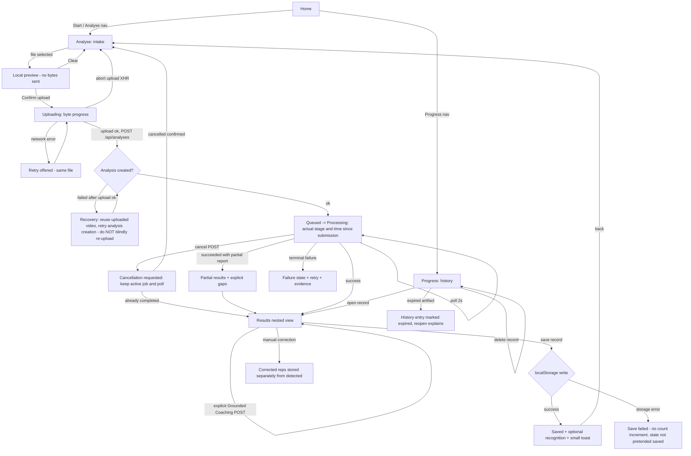

# HM-UX02 — New Cobalt Concept: Implementation TODO Plan (Planning Only)

**Status:** Proposed execution plan. **No implementation is approved or installed by this document.** The user explicitly paused coding: this file contains todos and the whole-flow plan only. Nothing below is a claim of completed work; every task has an unchecked gate that must be evidenced before it is marked done.

**Parent mapping:** this refines the HM-UX02 shell and HM-UX03 integration proposals in the earlier blueprint. The `UX2-*` items below are planning subtask IDs, not completed implementation. HM-UX01 and the earlier HM09 brief remain historical visual references.

**Date basis:** source-inspected state, 23 October 2026. Inspected: `apps/web/app/page.tsx`, `movement-report.tsx`, `grounded-coaching.tsx`, `globals.css`, `layout.tsx`; lifecycle/job contracts and private artifact route. [Preferred concept board](previews/HM-UX02-concept.png) is generated visual reference; depicted recording and character fidelity are not installed features.

---

## 1. New direction vs preserved old exploration

### New direction (target)
- Four-screen blue/white "board" concept: **Home / Capture / Review / Progress**, expressed as **3 nav destinations: Home, Analyse, Progress**, with **Results nested under Analyse** (own URL state, back button, deep links).
- Bright cool-white surfaces, cobalt ink/accents.
- Home actor: a **high-quality generic 3D sports-clad human-shaped companion** — an original, licensed asset. **Asset is pending selection**; we do **not** promise a realistic model built from procedural primitives. License and performance budget are accepted independently before integration. The companion is illustrative only: it is **never** an activation cue, never a user-body estimate, never labelled as measured movement.
- Photography/footage: analysis uses **real footage from the user only** (private, owner-scoped). No remote image generator produces analysis content. The new-concept PNG is a **visual reference only — generated, not an exportable component**, not shipped as UI.
- Mild, non-punitive progress feedback. **No** power currencies, penalties, or trading in MVP.

### Preserved old exploration (do not promote)
- `/ui-draft/index.html` prototype: labelled **simulated fixture data**, separate storage. Preserve as historical/reference only. Its numbers and timer must **never** be promoted into the real app.
- HM-UX01 and HM09 warm-orange design docs: kept for reference; superseded visually by the cobalt concept.

---

## 2. MVP scope and explicit feature cuts

### In scope (MVP)
1. Cobalt design tokens + 3-destination nav with nested Results, working browser back/forward and deep links (replaces local React view-state switching — a planned change, not yet done).
2. Home screen with pending licensed 3D companion (static fallback allowed) + entry to Analyse.
3. Upload intake (existing pipeline, unchanged services) with **local file preview before upload**, byte progress, cancel, retry, resume of pending job.
4. Existing real results feedback: owner-scoped `/result`, `/movement-report`, private `/artifacts/proxy` video, rep timelines seeking actual video, explicit Grounded Coaching POST.
5. Synchronised 2D pose overlay on the user's own video (capability-tested before exposure).
6. Gentle progress/save: local `mxr.logs.v1` records, manual correction, honest recognition (see §8).
7. QA behaviour checks + rollback plan.

### Cut from MVP (future, all unchecked)
- [ ] Record/set capture in-browser — **future progressive enhancement only, until capability-tested**. Upload must work regardless. Never advertise Record before it exists and is tested.
- [ ] Estimated 3D replay — optional cut line; if ever shown, labelled "estimated", never mislabelled as measured.
- [ ] Durable server workout log / recognition ledger — not assumed to exist.
- [ ] Accounts / cross-device sync — session stays guest-browser, owner-cookie scoped.
- [ ] Anti-cheat, competitive leaderboards, currencies, penalties, trading.
- [ ] Automatic provider calls — none pending; no paid calls on render (existing rule preserved).

---

## 3. Navigation model

### Destinations
| Nav | Route (planned) | Contains |
|---|---|---|
| Home | `/` | Companion, start CTA, honest status summary |
| Analyse | `/analyse` | Upload intake, active job state, queued/processing |
| Analyse → Results (nested) | `/analyse/results?analysis=UUID&exercise=id` | Video + report + coaching + save |
| Progress | `/progress` | History, saved records, recognition, deletion |

### Nested results / back / deep links
- Results is a **nested view under Analyse**, addressable via query params, preserving the existing deep-link contract `?analysis=UUID&exercise=id`.
- Browser back from Results returns to Analyse; forward returns to Results. State is derived from URL + server, not from React view state (current behaviour — local view state — is the thing being changed; this is planned, not done).
- Pending-job storage reload-resume is preserved: reloading mid-job restores the active job from storage and re-attaches polling.
- Predictable browser state: every nav destination and the nested Results view must survive refresh and share-link.

---

## 4. Whole flow

### Mermaid

### Accessible text version
1. From **Home**, the user chooses Analyse or Progress.
2. In **Analyse**, selecting a video shows a **local preview**; no bytes are sent until the user confirms.
3. On confirm, the app signs a session, uploads with real byte progress, and supports cancel and network-error retry with the same file.
4. After a successful upload, the app creates the analysis. **If analysis creation fails after the upload succeeded, the user is offered recovery that reuses the already-uploaded video — never a blind re-upload.**
5. The job moves through queued → processing with actual stage and **time since job submission**, derived from persisted `created_at`. Current contracts do not expose processing-start time; do not call this processing duration or reset it at 1.8 seconds. Polling stops at confirmed terminal states. Upload cancellation aborts XHR; job cancellation posts a request and remains pending until the server confirms the outcome.
6. Terminal job outcomes are failed, cancelled or succeeded. A succeeded report can be partial; partial quality is not a separate job lifecycle state. Show only evidence actually available on failure.
7. **Results** (nested under Analyse) shows the user's own private video, the measured movement report, rep timelines that seek the actual video, and an explicit Grounded Coaching action. No paid calls happen on render.
8. Saving writes a validated local record. **Only after the write succeeds** does the UI show saved state, a small toast, and any recognition. A storage error means no increment and no pretend-saved state.
9. Manual correction stores corrected reps **separately** from detected counts.
10. **Progress** lists history; entries can be reopened (deep link), deleted, or shown as expired when artifacts are gone. Deletion, reopen, and expiry are distinct states.

### First-time journey
Home (companion intro, no claims) → Analyse → consent + file pick → local preview → upload → processing with honest elapsed → Results → optional save → small toast → back.

### Returning journey
Home (status summary from validated local records only) → Progress → reopen a saved analysis via deep link, or start a new Analyse run. Expired artifacts are labelled, not silently broken.

---

## 5. State coverage matrix (all must be designed and tested)

| State | Required behaviour |
|---|---|
| Input / local preview | Preview from local file object; zero bytes sent; clear/confirm actions |
| Actual upload bytes | Real XHR byte progress (existing), not simulated |
| Queued / processing | Actual stage and time since `created_at`, not invented processing-start/ETA; poll 2s until terminal |
| Cancel | Abort in-flight upload; for created job POST cancel and poll until cancellation/completion is confirmed; then show outcome |
| Refresh / resume | Pending-job storage restores active job; polling re-attaches |
| Network retry | Retry polling without restarting the job; after upload success reuse asset ID and stable analysis request key. Ambiguous upload receipt must be explained; do not claim upload-level deduplication exists. |
| Partial | Show what exists; gaps explicit; no gap-filling of missing reps |
| Failure | Error + evidence + retry path; never invented data |
| Results evidence | Measured report + actual video; provenance visible (see §9) |
| Coaching | Explicit POST only; loading/error states; no auto-call |
| Post / quota | Quota or POST failure shown distinctly from analysis failure |
| Save success | Toast + record appears in Progress after confirmed write |
| Save failure | Storage error surfaced; **no count increment**; UI not marked saved |
| History expired | Entry kept, marked expired; reopen explains; distinct from deletion |
| Manual correction | Corrected reps separate field from detected; both visible with labels |
| Reopen vs deletion | Reopen navigates; deletion removes record after confirm; expired ≠ deleted |
| Recognition | Optional, honest, provenance-based (see §8) |
| One active job | A second upload is blocked while a job is active — prevents duplicates |
| Null vs 0 | **Strict:** `null` = unavailable with reason; `0` = an actual zero output. Zero completed cycles detected does not mean the user performed zero reps. Known resized-squat limit stays explicit. Never substitute zero for a missing score/count. |

---

## 6. Screen specifications

### 6.1 Home
- **Components:** licensed 3D companion (pending asset; static poster fallback), welcome/status summary, primary CTA, nav.
- **Primary action:** "Start analysis" → Analyse.
- **Actual data source:** validated `mxr.logs.v1` records for any summary numbers; nothing fabricated. If no records, honest empty copy.
- **Events → next state:** CTA → `/analyse`; nav → `/progress`.
- **Empty/error:** no records → friendly zero-state (not "0 workouts" as a claim); companion asset failure → static fallback, no layout break.

### 6.2 Analyse (intake + active job)
- **Components:** exercise picker (4 existing profiles), consent + CSRF flow (existing), file input, local video preview, upload progress bar (bytes), job status panel (queued/processing, real elapsed), cancel, retry, recovery prompt.
- **Primary action:** "Upload and analyse" (disabled while one active job exists).
- **Actual data source:** `/api/session`, XHR `POST /api/videos`, `POST /api/analyses`, status polling (all existing, unchanged).
- **Events → next state:** upload+create success → nested Results; terminal failure → failure panel; cancel → intake.
- **Empty/error:** no file → disabled CTA with guidance; network error → retry with same file; analysis-creation failure after upload → recovery reusing uploaded video.

### 6.3 Results (nested under Analyse)
- **Components:** private proxied video player, movement-report panel, rep timeline (seeks actual video), explicit Grounded Coaching button + result, reference-comparison block with provenance (see §9), save control, manual correction control, recognition toast.
- **Primary action:** contextual — review video; secondary explicit actions: coaching POST, save.
- **Actual data source:** owner-scoped `/result`, `/movement-report`, `/artifacts/proxy` (existing).
- **Events → next state:** save success → toast + Progress updated; back → Analyse.
- **Empty/error:** expired artifact → expired notice; report missing fields → null rendered as "not available", never 0; coaching error → inline retry.

### 6.4 Progress
- **Components:** record list (validated local records), recognition summary (provenance-labelled), reopen, delete-with-confirm, expired markers.
- **Primary action:** reopen a record → Results deep link.
- **Actual data source:** `mxr.logs.v1` (browser-local; no cross-device claims).
- **Events → next state:** reopen → Results; delete → confirm → list update.
- **Empty/error:** no records → honest empty state; corrupted entry → skipped with notice, never rendered as data.

---

## 7. Functional requirements

- **FR01 — Capture (future):** in-browser record/set capture is a future progressive enhancement, gated on capability testing. Not in MVP. Upload must work independently.
- **FR02 — Upload (must):** the existing upload pipeline (signed session, CSRF + consent, byte progress, analysis creation with `request_key`, polling, cancel, retry) must keep working end-to-end through the nav redesign.
- **Privacy:** server processing and private reports remain signed-owner scoped; mutations retain CSRF checks. Browser history and server media are distinct. Explain actual access expiry separately from physical erasure; never promise that clearing browser data deletes server video.
- **Navigation:** browser back/forward must work predictably; the change from React view-state to URL-driven state is planned, not yet implemented.

---

## 8. Recognition & progression rules (strict)

- Recognition derives **only** from the existing live measurement report, keyed by **unique analysisID + ruleVersion**, and only from a **saved record after persisted success**.
- No fabricated metrics, no manual counts as progression, no rewards from unreadable/failed analyses.
- MVP labels: local, mutable, non-competitive; **no anti-cheat**.
- **Storage error cannot increment.** Counts are recalculated locally from validated saved records only, each carrying provenance recognition metadata.
- Existing logs lack the eligible provenance field → **no retroactive awards** from detected reps alone.
- Post-set feedback: small toast; rest is never punished; no streaks/penalties.
- Rep selection uses **original segment IDs and timestamps**; overlays use canonical aspect/rotation/object-fit and respect support visibility; **no gap-filling** of missing segments.
- Estimated 3D is optional and behind the cut line; the generic athlete companion is never presented as measured user movement.

---

## 9. Reference comparison
- The experimental reference-resemblance score stays **separate and provisional** (existing). Details **and provenance must be accessible — not buried — whenever they affect a claim**: what was compared, which reference, which rule version, and that it is experimental. Top score remains nullable and distinct from resemblance.

---

## 10. Dependency tasks (all unchecked; nothing done)

File boundaries: **current** — `app/page.tsx` (view switching), global styles, `movement-report.tsx`, coaching panel. **Proposed components** — `components/nav/`, `components/home/Companion.tsx`, `components/analyse/Intake.tsx`, `components/analyse/JobStatus.tsx`, `components/results/*` (refactor of existing), `components/progress/*`, `lib/recognition.ts`, `lib/pendingJob.ts` (formalise existing), `styles/tokens.css`. Existing services/APIs unchanged.

### UX2-01 — Baseline preservation & evidence snapshot — MUST
- [ ] Record current behaviour (upload, polling, cancel, retry, deep link, save) as checkable baseline
- [ ] Freeze `/ui-draft` as reference-only with a visible "simulated data" label
- FRs: FR02 | Depends: none
- **Done gate/test:** baseline checklist reproducible on current build; no source changes

### UX2-02 — Cobalt tokens + 3-destination nav with nested Results — MUST
- [ ] `styles/tokens.css` (cool white / cobalt ink), applied without breaking existing layout
- [ ] URL-driven nav: Home / Analyse / Progress; Results nested with `?analysis=&exercise=`; back/forward/refresh correct
- FRs: FR02, navigation | Depends: UX2-01
- **Done gate/test:** browser back/forward/refresh/deep-link behaviour checks pass; old view-state path removed or inert

### UX2-03 — Home + companion shell — MUST (asset itself: independent acceptance)
- [ ] Home screen per §6.1 with static fallback
- [ ] Companion asset: license + performance budget reviewed and accepted **independently** before integration; illustrative-only labelling
- [ ] Pointer rotation with button/keyboard alternatives, front/back views, exercise-target selection, reduced motion; companion never obstructs Analyse. Original/appropriately licensed mesh selection is a separate art spike, not a promise to reproduce generated art exactly.
- FRs: — | Depends: UX2-02
- **Done gate/test:** fallback renders with asset absent; no measured-movement claims; perf budget evidence

### UX2-04 — Analyse intake: local preview + one-active-job + recovery — MUST
- [ ] Local preview before any bytes sent; clear/confirm
- [ ] One-active-job guard (prevents duplicates)
- [ ] Recovery path: analysis-creation failure after successful upload reuses uploaded video
- FRs: FR02 | Depends: UX2-02
- **Done gate/test:** behaviour checks: preview sends 0 bytes; duplicate blocked; recovery does not re-upload

### UX2-05 — Existing real results feedback preserved in nested view — MUST
- [ ] Results nested route renders existing report/video/coaching with null-vs-0 strict rendering
- [ ] Reference-comparison provenance block accessible
- FRs: FR02 | Depends: UX2-02
- **Done gate/test:** deep link opens identical data as current `/result`; null fields render "not available"

### UX2-06 — Synchronised 2D pose overlay — MUST for the depicted review experience
- [ ] Overlay on user's own video; canonical aspect/rotation/object-fit; support visibility respected; original segment IDs/timestamps; no gap-fill
- [ ] Capability test before exposure; hidden behind flag until proven
- FRs: — | Depends: UX2-05
- **Done gate/test:** sync accuracy check against actual video timestamps; flag off = no UI trace

### UX2-07 — Save/history — MUST; gentle recognition — SHOULD
- [ ] Fix save ordering: React state updates **after** localStorage success (small UI dependency fix before any recognition)
- [ ] Recognition per §8: unique analysisID+ruleVersion, provenance metadata, no retroactive awards, storage error cannot increment
- [ ] Manual correction stored separately; expired vs deleted distinct; small post-set toast
- FRs: — | Depends: UX2-02
- **Done gate/test:** simulated storage failure → no increment, no pretend-save; recalc from validated records only

### UX2-08 — QA behaviour suite + rollback — MUST
- [ ] Checks: deep-link round trip; cancel polls through confirmed terminal outcome; polling retry without resubmission; upload/create recovery; null-vs-0; save failure; expired history; one-active-job; no paid calls on render
- [ ] Rollback: retain a tagged/committed working baseline and use non-destructive storage evolution. Demonstrate a rollback without deleting history; a temporary UI flag is optional, not a new mandatory framework.
- FRs: all | Depends: UX2-04..07
- **Done gate/test:** all checks evidenced; rollback demonstrated

### UX2-09 — Companion polish + motion (independent) — COULD / future
- [ ] Non-blocking; may start after UX2-02 tokens; must never block core upload/results path
- FRs: — | Depends: UX2-02 | **Done gate:** perf + license evidence; core flows unaffected

---

## 11. Suggested sequence
1. UX2-01 preserve baseline → 2. UX2-02 tokens/nav → 3. UX2-03 Home + intake (with UX2-04) → 4. UX2-05 existing real results feedback → 5. UX2-06 sync 2D pose → 6. UX2-07 gentle progress/save → 7. UX2-08 QA + release. UX2-09 companion can run independently after tokens but never blocks core.

### Ownership, effort and review checkpoints

S = one small bounded slice; M = several checked slices; L = uncertainty requiring
an evidence/art spike. These are relative effort bands, not hours or delivery dates.
Paths below are proposed boundaries; create only components actually needed.

| Task | Files / owner boundary | FR mapping | Band |
|---|---|---|---|
| UX2-01 | Evidence in `docs/audit/`; no app edits | FR02/03/10/12 | S |
| UX2-02 | `apps/web/app/layout.tsx`, `globals.css`, shared navigation and URL/view adapter | FR03/12; app shell | M |
| UX2-03 | Home/Companion components; separately licensed model/renderer assets | FR06/10; illustrative companion | M; art L |
| UX2-04 | Intake/local-preview/JobStatus components; existing `page.tsx` flow extraction | FR02/03/06/12 | M |
| UX2-05 | Results composition, existing `movement-report.tsx` and `grounded-coaching.tsx` | FR07/08/09/10/12 | M |
| UX2-06 | New pose/video overlay reader and renderer; private-artifact consumer only | FR04/10/12 | L |
| UX2-07 | History/save adapter and optional versioned recognition reducer; local schema reader | FR05/12; product log/progress extension | M |
| UX2-08 | Focused tests, browser acceptance evidence, rollback notes | FR02/03/06–10/12 | M |
| UX2-09 | Approved character asset/motion refinements only | FR10; illustrative companion | M–L |

Batch A: prove UX2-01/02 and inspect the first working shell before further drafting.
Batch B: disjoint Home/character, intake/status and Results tasks (at most3 workers),
one integrating writer. Shared `page.tsx` ownership stays with that writer: workers
return isolated components or exact patches, never competing page rewrites.
Batch C: save/history, proven 2D overlay, final QA. Repeat checks after integration.
Cut recognition, character customisation and 3D motion replay first if they threaten
the usable upload → actual feedback → save loop. Never cut privacy or missing-value handling.

## 12. Roadmap & decision gates
- **Now (MVP):** UX2-01..08, with recognition within07 secondary. The depicted pose-overlay review must pass UX2-06 before being presented as available. Any reduced release without it needs an explicit scope decision.
- **After MVP:** UX2-09 character polish and richer comparable-set history.
- **Validation-gated:** FR01 recording needs browser permissions/codec/device tests and upload fallback. Estimated 3D replay needs real canonical pose, source-time synchronisation, valid-joint masks and honest missing/depth limits; a label alone is insufficient.
- **Long term:** durable server log, accounts — only after explicit product decision.
- **After a useful return loop is observed:** opt-in weekly challenges and cosmetic character choices; test motivation and distraction with beginners/casual users before expanding mechanics.
- **Later exploratory:** bounded cosmetic exchange/randomness, photo-derived avatars or social challenges require separate consent, moderation, incentive and cost review. No rest-day penalties or monetary trading are proposed for MVP.
- **Gates:** professional review + held-out evaluation before any strong movement claims. Technical thread owns metrics/calibration. Effort expressed in bands (S/M/L), **no promised calendar dates**, no automatic providers pending.

## 13. Delegation & budget guardrails
- Delegation packets: **max 3 disjoint workers**, batches ≤4, one integrating writer; **first prove 1 packet succeeds** before fan-out.
- Caps ledger: track spend per packet; on generation failure, **stop rather than rewrite**. Last known aggregate task budget max USD 15.54938365 (unverified invoice); conservative USD 70 active / USD 30 protected backup; 200k task ceiling. All runtime/checks in Docker. No Addy skill. UI UX Pro Max local guide approved; user prefs override templates.

## 14. Defaults recorded (no interview needed)
- Default: cobalt/white per concept PNG (reference only). Companion illustrative with licence/performance review and static fallback. Recognition rules remain proposed and are cuttable; save/history works without them. **Remaining art decisions** (exact character, motion intensity, illustration set) do **not** block core upload/results work.

---

## Next action on approval
When the user asks to start implementation, run **UX2-01 then UX2-02** first: baseline evidence snapshot, then cobalt tokens and URL-driven navigation with a demonstrated rollback. Execution is paused while this plan is discussed.

## Owner tour (2 minutes)
1. §1–2: what's new (cobalt, companion, 3 nav) vs preserved (old prototype as reference only); MVP cuts.
2. §4: the whole flow, including the no-blind-reupload recovery.
3. §5 + §8: the honesty rules — null vs 0, save-after-write, provenance-based recognition.
4. §10: nine unchecked tasks with done gates; §13: budget caps and stop-on-failure.
5. Approve, adjust scope, or keep planning — nothing is built yet.
